# JustSlides

**Made for presenting, not decorating.**

An agent skill for Claude Code and Codex that turns a topic into a finished, click-by-click
slide deck with a speaker script, as a single HTML file.

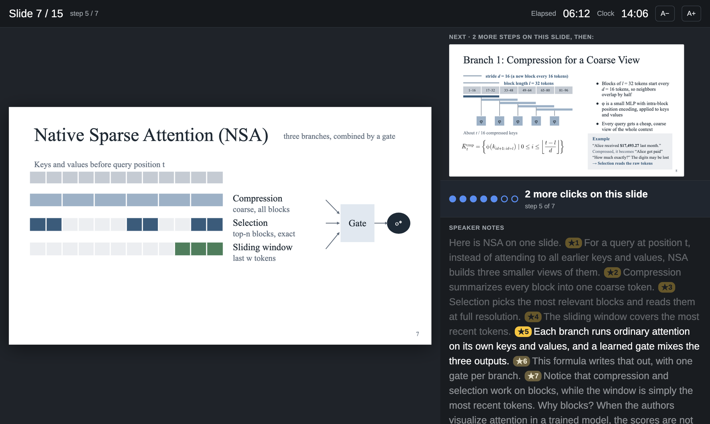

## What This Does

Most slide generators stop at how the slides look. JustSlides is about how you give the talk.
The style stays plain on purpose: white slides, one serif typeface, one accent color, so the
audience follows your argument instead of the decoration. You give it a topic, and it plans
the talk, builds every diagram one click at a time, and writes what to say after each click. You get one `.html` file that opens in any browser. You
present it with the arrow keys, and your notes follow along in a second window.

It is built for teaching and research talks: lectures, discussion sections, micro-teaching
lessons, group meetings and paper presentations.

### Key Features

- **Speaker notes tied to clicks**: the script is split by `★`, one segment per click, and the
  sentence you should be saying right now is highlighted.
- **Presenter view**: a second window with a timer, the next slide, and how many clicks are
  left on this slide. It stays in sync with the projector window.
- **Built step by step**: boxes appear one at a time, arrows draw themselves, numbers count up,
  and elements glide between slides like Keynote's Magic Move.
- **Academic structure**: hook, one running example, one idea per slide, evidence, discussion
  questions, takeaways. Real citations in footnotes, no invented numbers.
- **Checks its own work**: a checker catches mismatched clicks and notes, and a screenshot
  script lets the agent look at every slide and fix overflow before handing it over.
- **Zero dependencies**: one HTML file with inline CSS and JS. No npm, no build step, works
  offline.

## 🎤 Presenting: the only part you do yourself

Everything else is automated. On stage, open the `.html` file in a browser and use these keys.

| Key | Action |
|---|---|
| ➡️ `→` `Space` `Enter` | **next click**, then next slide |
| ⬅️ `←` `Backspace` | previous click / slide |
| ⏭️ `Shift+→` / `Shift+←` | skip a whole slide forward / back |
| 🧑‍🏫 `P` | **presenter view** in a second window |
| 📝 `N` | notes panel under the slide (same window) |
| 🔲 `G` | overview grid of all slides, click one to jump |
| ✨ `A` | animations on / off |
| 🖥️ `F` | fullscreen |
| ⏮️ `Home` / `End` | first / last slide |
| 🖨️ `Cmd/Ctrl+P` | print to PDF, one page per slide |

🖱️ Clicking the right two-thirds of the slide advances and the left third goes back. 📱 Swipe
works on touch screens. 🔗 `deck.html#7` opens slide 7.

💡 **Recommended setup for a talk:** open the deck, press `F` for fullscreen on the projector,
then press `P` and drag the presenter window to your laptop screen.

## Gallery

### Generated from one prompt

[`output/paper-diffusion-transformers.html`](output/paper-diffusion-transformers.html) was made
by the skill from the prompt *"create slides explaining DiT"*: 14 slides, 43 clicks, full
speaker script.

<p>
  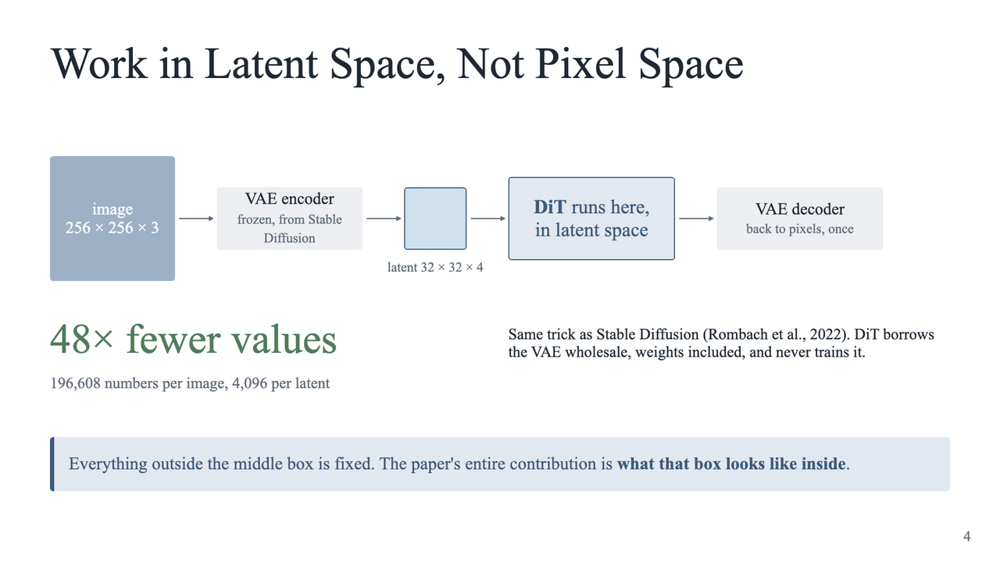
  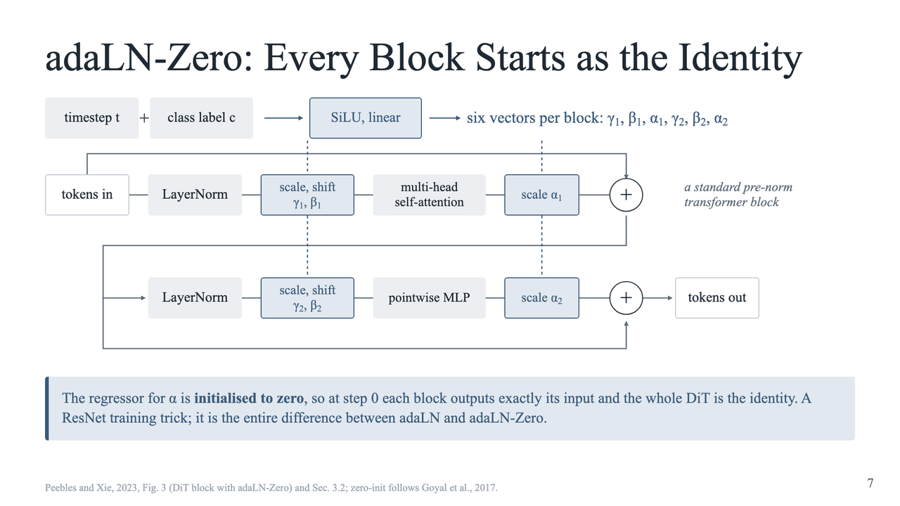
  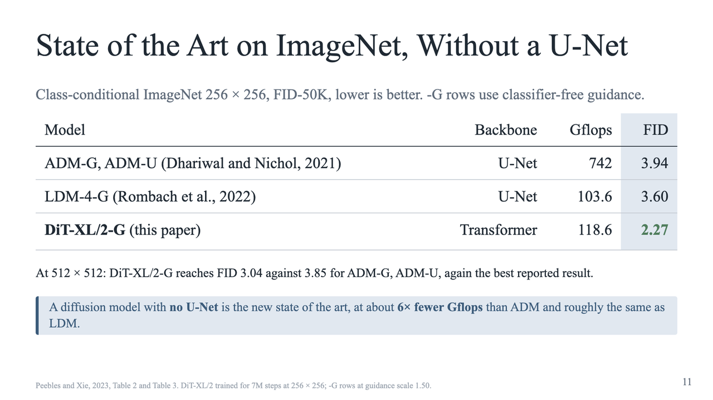
</p>

### Examples the skill learns from

Open any of these in a browser and press `→`.

**[Paper presentation: Native Sparse Attention](examples/paper-native-sparse-attention.html)**
shows magic move, fade-outs, count-ups and embedded figures.

<p>
  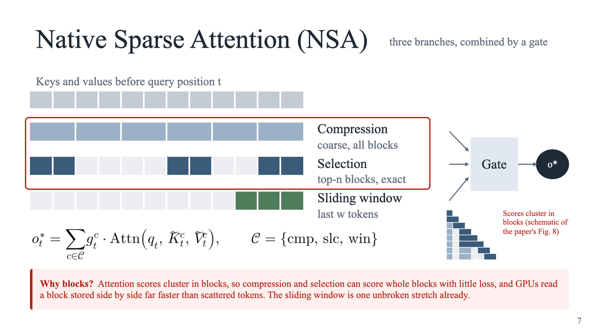
  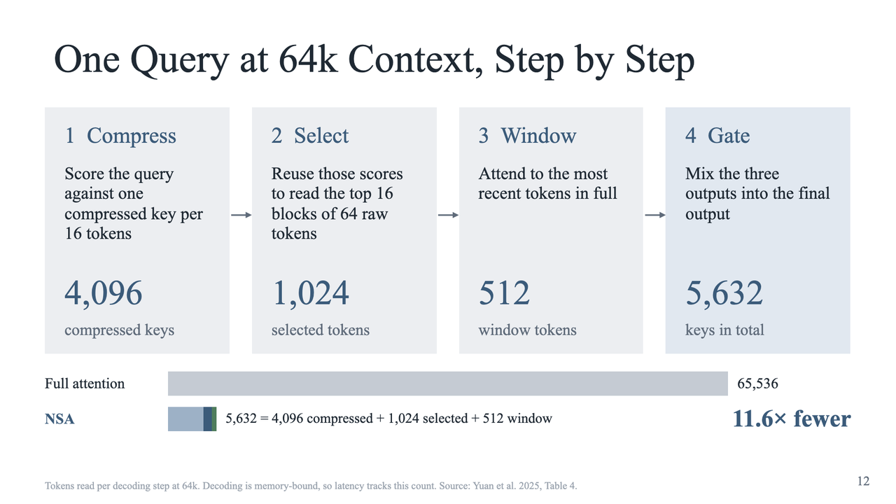
  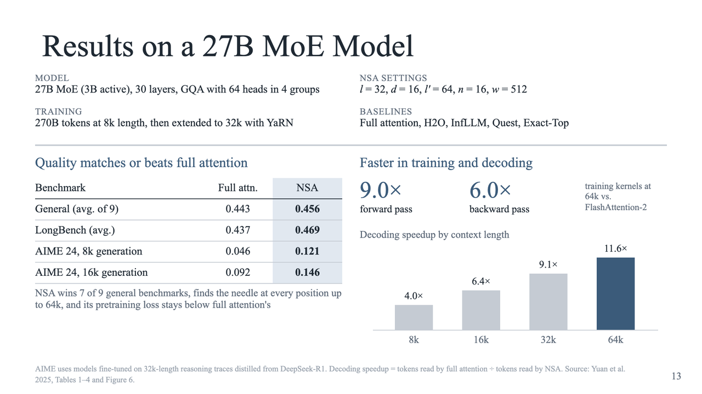
</p>

**[Teaching lesson: Binary Search](examples/lesson-binary-search.html)** shows polls,
exercises, a playable guessing game, and a tree built one level at a time.

<p>
  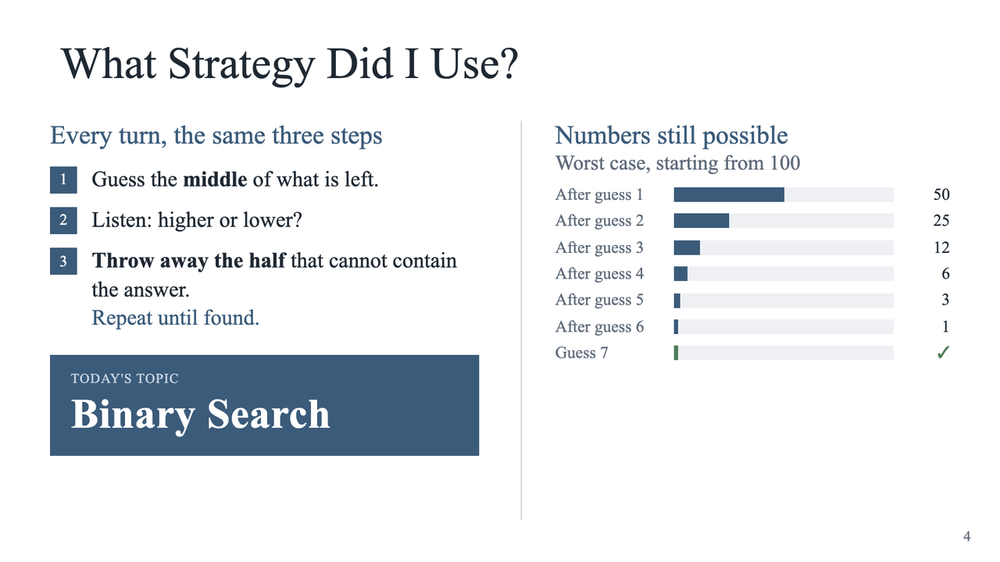
  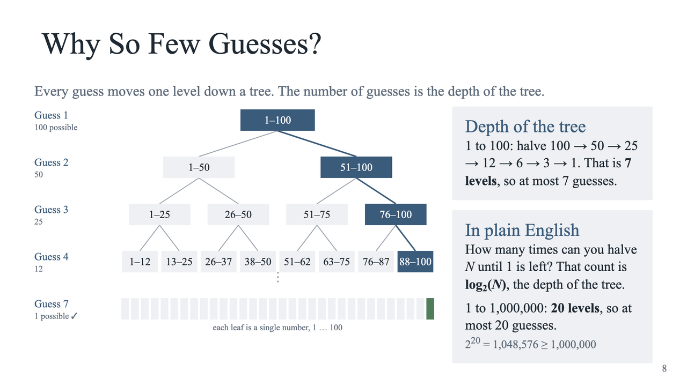
  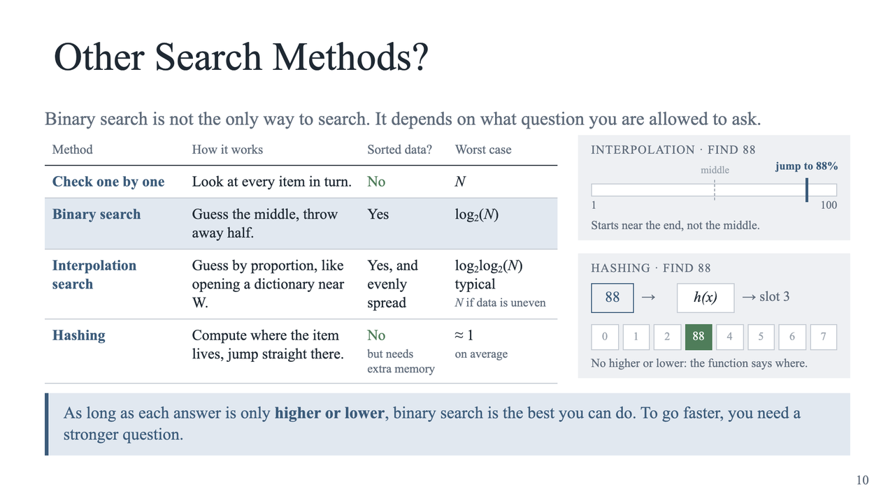
</p>

**[Course discussion: Agents and Images](examples/discussion-agents-and-images.html)** shows
box-and-arrow diagrams, SVG connectors and discussion questions.

<p>
  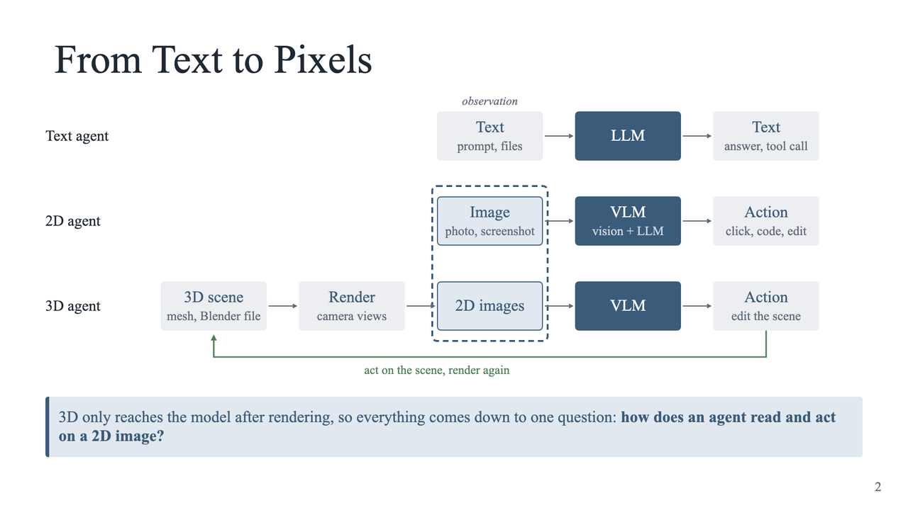
  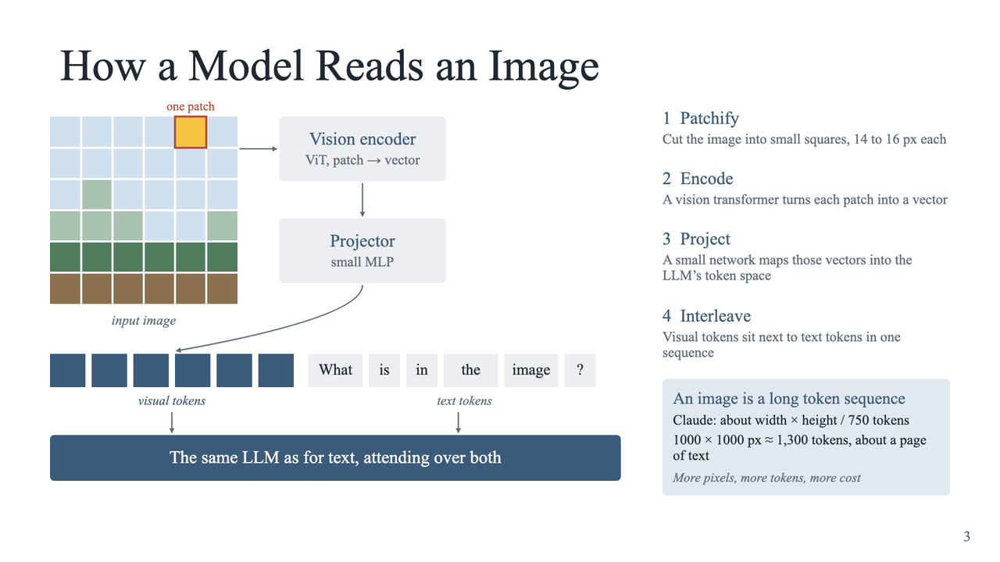
  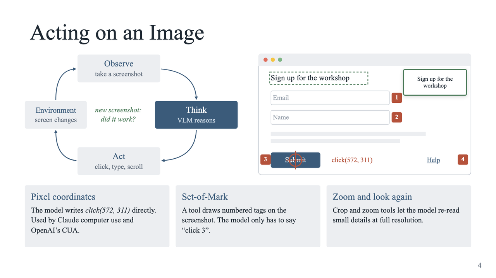
</p>

## Installation

### Claude Code

Clone the repository and start Claude Code inside it. The skill in `.claude/skills/justslides/`
is picked up automatically.

```bash
git clone https://github.com/YumengHe/JustSlides.git
cd JustSlides
claude
```

To use it in every project, copy the skill into your personal skills directory:

```bash
cp -R .claude/skills/justslides ~/.claude/skills/
```

### Codex and other agents

The skill is plain Markdown. Send the agent this repo link and ask it to use the JustSlides
skill, or point it at `.claude/skills/justslides/SKILL.md`. Everything the skill needs (engine
template, layout snippets, checker, screenshot script) is inside that folder.

## Usage

```text
/justslides make a 15-minute lecture on public-key cryptography for a second-year CS class
```

or just ask for slides in plain words; the skill triggers on "slides", "deck", "lecture",
"paper presentation", "幻灯片", "课件" and similar. The skill will:

1. Ask who is presenting, unless it already knows
2. Outline the talk, about one slide per minute, with what each click reveals
3. Write the slides into `output/<type>-<topic>.html`, where the type is `lesson`,
   `discussion` or `paper`
4. Write the full speaker script, one `★` segment per click
5. Run the checker and screenshot every slide to fix layout problems
6. Tell you the file path, slide count and how to present

## Repository layout

```
.claude/skills/justslides/
├── SKILL.md               instructions the agent follows
├── template.html          engine + two placeholder slides; every new deck starts as a copy
├── reference/patterns.md  copy-paste snippets for 17 slide types
├── scripts/check_deck.py  validates click counts, notes and JS syntax
└── scripts/screenshot.sh  renders every slide to PNG with headless Chrome
examples/                  finished decks that show the style
output/                    decks generated by the skill
assets/                    images used in this README
```

## Writing a deck by hand

Copy `template.html`, add `<section class="slide">` blocks between the `SLIDES START/END`
markers, and add one string per slide to the `NOTES` array. Three attributes drive the
animation:

```html
<section class="slide" data-steps="2">                <!-- number of clicks on this slide -->
  <div class="ttl a fx-down" data-s="0">Title</div>    <!-- data-s: appears after click k -->
  <p class="txt a fx-up" data-s="1" style="--d:.2s">… <!-- --d: delay within the click -->
  <div class="call a fx-up" data-s="2">…</div>
</section>
```

In the notes, `★` marks a click: the text after the k-th `★` is what to say after click k, so
each note contains exactly `data-steps` stars. Run the checker to confirm:

```
python3 .claude/skills/justslides/scripts/check_deck.py my-deck.html
```

See `reference/patterns.md` for cards, tables, diagrams, magic move, fade-outs, count-ups and
interactive widgets.

## License

MIT. See [LICENSE](LICENSE).
